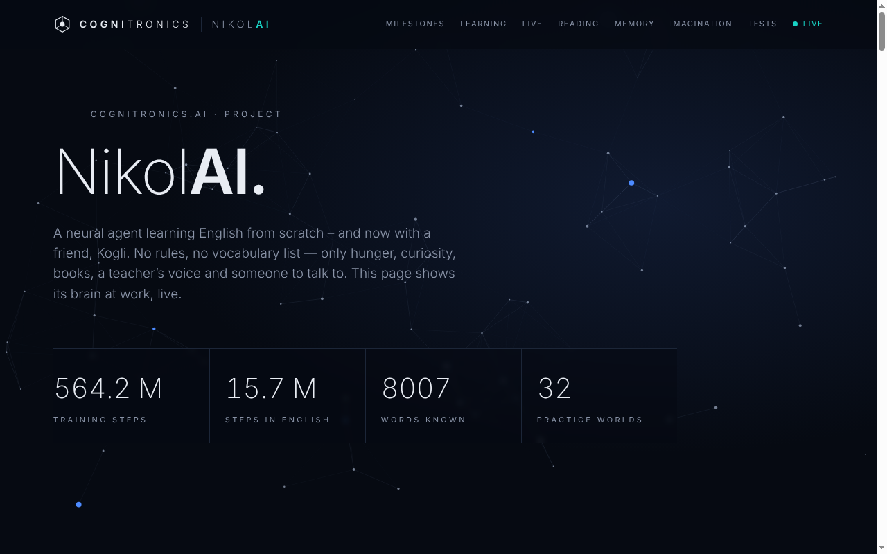
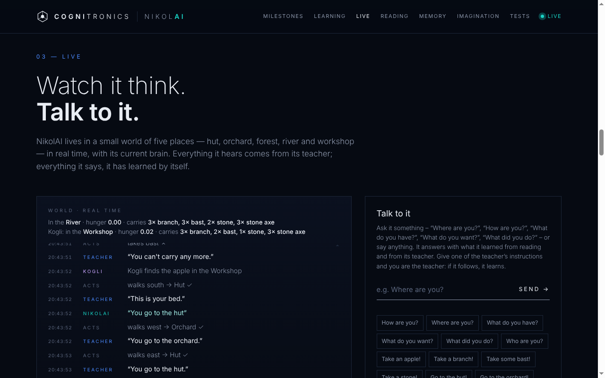

# NikolAI

> ### 🟢 Watch it learn – live: **[nikolai.cognitronics.ai](https://nikolai.cognitronics.ai)**
> NikolAI is running right now on a small home server. The public page shows its world, what it hears and says,
> its training curves, its word memory, how it imagines things and every test – updated in real time.

[](https://nikolai.cognitronics.ai)

*A Cognitronics project.* A neural creature that learns English from scratch – in a small world of its own, with a
teacher, a friend, and books. No sentence rules, no vocabulary list, no planner. It gets its senses (where am I, what
do I see, what do I carry, how hungry am I), hears what is said, reads, and learns. Everything it says, it has
learned by itself.

[](https://nikolai.cognitronics.ai/#live)

*Above: the live view – NikolAI and its friend Kogli in their world, the teacher's words and NikolAI's own answers,
second by second.*

## What it does

- **Lives in a world.** Five places (hut, orchard, forest, river, workshop), real things (apples, branches, bast,
  stones), real rules: hunger grows, apples ease it, a branch + a stone + bast make a stone axe at the workbench.
  Apples are scarce; windfall apples lie somewhere different each time; on some practice days the tree bears nothing.
- **Learns from experience.** Reinforcement learning (PPO, Schulman et al. 2017) with rewards from its body (hunger),
  its curiosity – the error of its own world model (Pathak et al. 2017) – and the teacher's praise.
- **Learns language in its world.** A teacher describes what it does, names things, gives instructions, asks
  questions ("Where are you?") and listens. NikolAI learns to follow instructions, describe what happened, repeat,
  ask for what it needs, ask where food is, and answer questions about itself. Hindsight relabelling turns every
  action into a lesson ("you took a stone" → "Take a stone!"; Andrychowicz et al. 2017, Chan et al. 2019).
- **Reads like a child.** Before entering its world it reads the BabyLM corpus (Warstadt et al. 2023): ~100 million
  words written or spoken by people – parents talking to toddlers, conversations, children's books, subtitles, Simple
  Wikipedia. That reading brain (a GRU language model) becomes its hearing and speaking; it keeps reading alongside.
- **Has a friend.** Kogli shares its world (own body, same brain – like a twin). They hear each other and share in
  each other's meals, so telling the hungry one where an apple lies pays off.
- **Imagines.** Things have real properties (colour, size, shape, surface, parts, weight, taste) that it only finds
  out by seeing, taking, carrying and eating. From a heard word it predicts what to expect – with an uncertainty.
  The dashboard draws this: sharp where it knows, fog where it doesn't (predictive coding; Rao & Ballard 1999).
- **Combines words.** Apples, branches and stones come big or small; a big apple fills more. The teacher says "Take
  a small stone!" or "Eat the big apple!" – but never "big stone". Does NikolAI understand it anyway, from "big"
  heard with apples and branches and "stone" heard only as "small stone"? That is the classic test of systematic generalisation
  (Lake & Baroni 2018; Hill et al. 2020), and small networks often fail it.
- **Shows its word memory.** A word cloud of what it says, the words closest to any word in its head (from books and
  from its world), and an Obsidian vault of all of it.

## Honest notes

- It is small (~9 M parameters, most for its 8,000 words). It writes grammatical but meandering stories, and its
  answers come from a tiny world. It is a toddler with a picture-book voice, not a chatbot.
- It practises in 32 copies of the world at once; the dashboard shows one NikolAI living in real time.
- The senses are given (like eyes and a stomach), and so is the "paint box" of its pictures. Its hands can choose
  "any", "a big one" or "a small one" – which one to choose when, and what "big" means, is learned.
- **Every claim is tested** against controls: with the sentence, without it, and acting at random; made-up words for
  words it only knows from books; guessing the most frequent answer. "Understood" means ≥ 70 % and ≥ 30 points better
  than without. A milestone counts only after three tests in a row. Failures are shown too.

## Tests (dashboard → Tests)

| Phase | Question |
|---|---|
| 1 | Does it feed itself? |
| 2 / 2b | Does it follow trained instructions – and two it was never trained on? |
| 3 | Does it describe what just happened? |
| 4 – 4d | Does it ask for an apple when hungry, for what is missing to build, in first person, and repeat on request? |
| 5 / 5b | Does it use a hint where food is – and ask "where …?" when hungry? |
| 6 / 6b | Does it read well (perplexity vs. word frequency)? Does it understand words it only knows from books (vs. a made-up word)? |
| 7 | Does it answer questions about itself truthfully (vs. guessing)? |
| 8 | Does it tell its friend where food is (vs. the line cut)? |
| 9 | Does it imagine what it knows – and stay unsure about what it never touched? |
| 10 / 10b / 10c | Does it pick the big or the small one on request (vs. the sentence without the size) – also for combinations it never heard? Does it imagine a "big stone" bigger than a "small stone"? |

## Install (Linux)

```bash
python3 -m venv ~/nikolai/neuro-venv
~/nikolai/neuro-venv/bin/pip install torch --index-url https://download.pytorch.org/whl/cpu
git clone https://github.com/Cognitronics/nikolai ~/nikolai/code

# books: the BabyLM corpus (~550 MB)
mkdir -p ~/nikolai/books/babylm && cd ~/nikolai/books/babylm
for f in aochildes bnc_spoken cbt children_stories gutenberg open_subtitles qed simple_wikipedia switchboard wikipedia; do
  wget -c https://huggingface.co/datasets/cambridge-climb/BabyLM/resolve/main/clean/100M/$f.txt
done

# 1. read for 8 hours, then 2. live
cd ~/nikolai/code
python -m neuro.reading --book ~/nikolai/books/babylm --reader ~/nikolai/data/reader.pt --hours 8
python -m neuro --web 8091 --host 0.0.0.0 --save ~/nikolai/data/brain.pt \
    --reader ~/nikolai/data/reader.pt --book ~/nikolai/books/babylm --public-port 8092 --obsidian ~/nikolai/obsidian
```

`nikolai-reading.service` and `nikolai-neuro.service` do the same with systemd (adjust user and paths); the reading
service stops NikolAI while it reads and starts it again afterwards. Dashboard: `http://<host>:8091` (private, you can
talk to it), `:8092` read-only for a public page. The brain is saved every 10 minutes and on stop. Brains saved by
older versions (with German names) load as they are.

## Files

| File | What it does |
|---|---|
| `neuro/world.py` | The world: places, things, hunger, recipe, windfall, shared worlds |
| `neuro/teacher.py` | The teacher: describes, names, instructs, asks, listens, hints |
| `neuro/brain.py` | The neural brain: perception, hearing, memory, acting, world model, speech, imagination |
| `neuro/practice.py` | Practice: PPO, curiosity, hindsight, repeating, answering, reading, imagination |
| `neuro/evaluation.py` | All tests and milestones |
| `neuro/reading.py` | Reading: books, vocabulary, language model, pre-reading |
| `neuro/imagination.py` | Properties of things, the senses that reveal them |
| `neuro/memory.py` | Word cloud, nearest words, Obsidian vault |
| `neuro/server.py` | Continuous practice, live world with NikolAI and Kogli, web server |
| `neuro/dashboard.html` | The dashboard (Cognitronics design) |
| `neuro/legacy.py` | Loads brains saved by older versions |
| `nikolai-public.sh` | Sets up the public page behind Nginx Proxy Manager |

## History

- **1–4** Neural brain in a text world; speaking as an action; first tests with controls; English dashboard.
- **5** NikolAI learns English (before: German).
- **6** Hidden knowledge (windfall apples), hindsight relabelling, instructions against habit.
- **7** Reading (TinyStories first); words only known from books (Hill et al. 2020) with a made-up-word control.
- **8** Answering questions about itself; chat on the dashboard.
- **9** Reading like a child: BabyLM instead of GPT-written stories.
- **10** A friend, Kogli: shared world, hearing each other, shared reward.
- **11** Rest days; fair word tests.
- **12** (not released) experience replay – tested against version 11 in two runs each, no benefit.
- **13** Public read-only port; a teacher change that made things worse was reverted after testing.
- **14** Word memory: word cloud, nearest words, Obsidian vault.
- **15** Imagination: properties, expectations with uncertainty, pictures from them.
- **16** All code in English; old brains still load.
- **17** Sizes and combining words: big and small things, one held-out combination ("big stone"), Phase 10. First
  test (two one-hour runs from a trained brain): it starts to pick big or small branches on request; for the
  never-heard "big stone" its hands still take the small one (it only ever heard "small stone") – but its
  imagination already pictures a big stone about twice as big as a small one.

## Next

Drawing for Kogli from its imagination (a picture game where the two invent their own signs), more properties to
combine (colour, ripeness), a bigger reading brain (a small transformer).

## Support

NikolAI is built and trained in spare time on a small home server. If you'd like to help cover hardware and
electricity, you can [support the project via PayPal](https://paypal.me/cognitronics) – thank you! ♥

## License

MIT – see [LICENSE](LICENSE).
